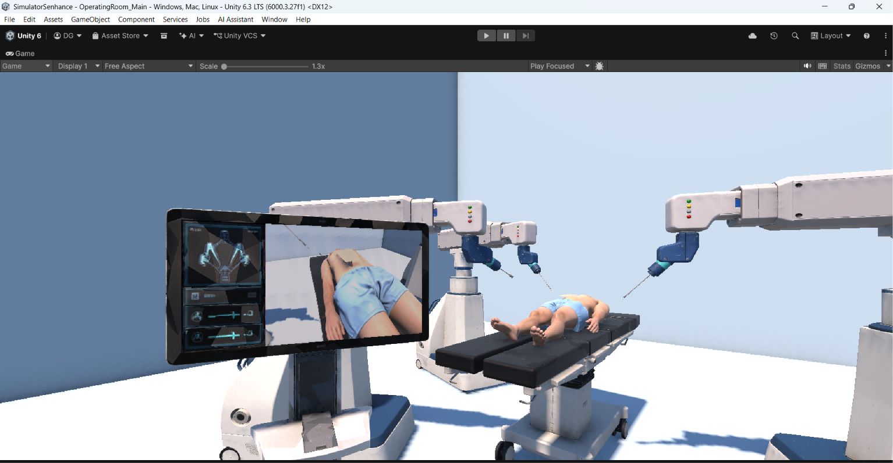
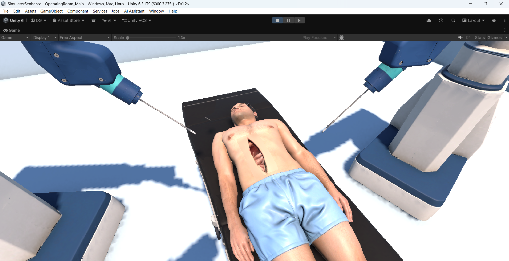
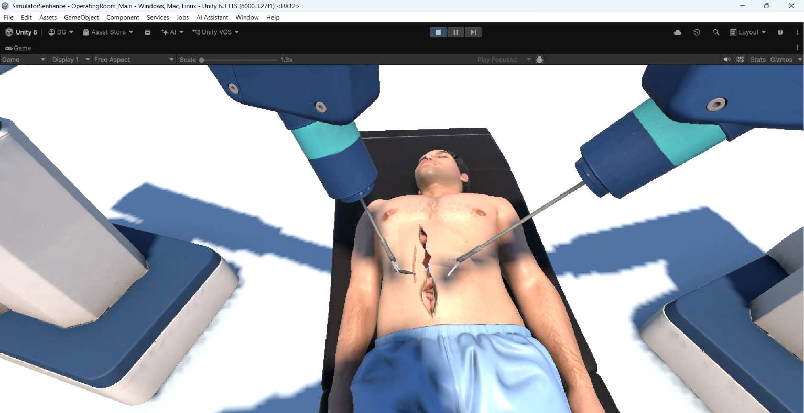
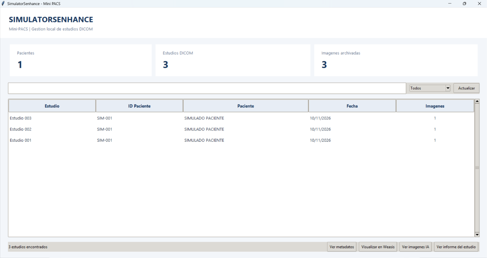
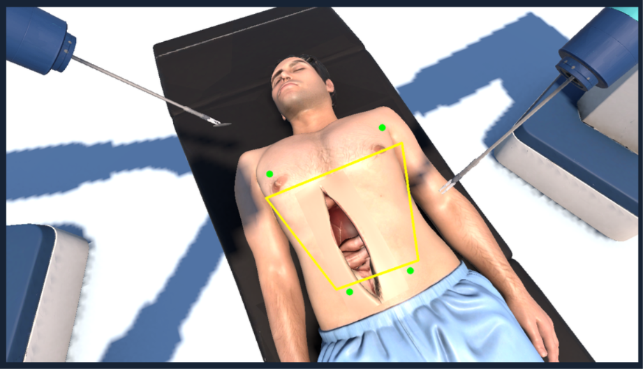
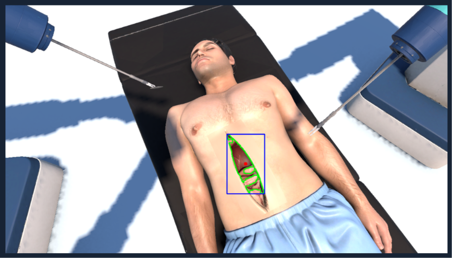
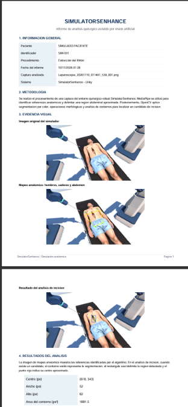

# Guía de Usuario – SimulatorSenhance

**Proyecto:** Sistema Asistido por Robot Quirúrgico Senhance  
**Desarrollador:** Diego Alejandro García García  
**Miniproyecto:** #3 – Ingeniería Biomédica  
**Año:** 2026

---

## 1. Introducción

SimulatorSenhance es un entorno virtual de simulación quirúrgica desarrollado en Unity, inspirado en el sistema robótico Senhance de Asensus Surgical.

El proyecto permite manipular brazos robóticos, controlar instrumentos quirúrgicos y realizar procedimientos simulados mediante un control inalámbrico DualShock 4.

Adicionalmente, incorpora herramientas para capturar imágenes, generar estudios DICOM, realizar análisis experimentales mediante inteligencia artificial y visualizar los resultados desde un Mini-PACS local.

Esta guía explica el funcionamiento general del simulador y sus principales herramientas.

## 2. Requisitos del sistema

### Hardware

- Computadora compatible con Unity 6.
- Control DualShock 4 (PS4).
- Conexión Bluetooth o USB.
- Espacio de almacenamiento para capturas y estudios.

### Software

- Unity Hub y Unity 6.
- Python con las dependencias indicadas en `src/api/requirements.txt`.
- Weasis para visualizar archivos DICOM.
- Proyecto SimulatorSenhance.

Para instalar y configurar los componentes, consultar el [Documento Técnico](docs/documento_tecnico.md).

## 3. Inicio del simulador

1. Abrir Unity Hub.
2. Seleccionar el proyecto SimulatorSenhance.
3. Abrir la escena `OperatingRoom_Main`.
4. Conectar el DualShock 4 mediante Bluetooth o USB.
5. Verificar que el mando sea reconocido.
6. Presionar **Play** para iniciar la simulación.

Una vez iniciada la escena, se puede manipular el sistema robótico dentro del entorno quirúrgico.



*Figura 1. Entorno quirúrgico virtual de SimulatorSenhance.*


## 4. Controles del DualShock 4

El sistema utiliza controles independientes y simétricos para los brazos izquierdo y derecho, además del control de cámara laparoscópica y cambio de vistas.

### 4.1. Movimiento de los brazos robóticos

| Función | Brazo izquierdo | Brazo derecho |
|---|---|---|
| Movimiento horizontal (X) y profundidad (Z) | Joystick izquierdo | Joystick derecho |
| Movimiento vertical (Y) | L1 + joystick izquierdo | R1 + joystick derecho |
| Apertura y cierre de pinza | L2 | R2 |
| Modo precisión | Cruceta abajo | Botón X |
| Elevar el sistema o brazo | Cruceta arriba | Triángulo |
| Bajar el sistema o brazo | L1 + cruceta arriba | R1 + Triángulo |
| Acercar o alejar la pinza | Cruceta derecha | Cuadrado |

### 4.2. Control de cámara laparoscópica

| Función | Lado izquierdo | Lado derecho |
|---|---|---|
| Alternar entre brazo y cámara | Cruceta izquierda | Círculo |
| Movimiento de cámara | Joystick izquierdo | Joystick derecho |
| Control de iluminación | L2 | R2 |
| Regresar al control del brazo | Cruceta izquierda | Círculo |

**Nota:** Al activar el modo cámara, el brazo y la pinza del lado seleccionado dejan de recibir órdenes de movimiento. El otro brazo puede continuar funcionando.

### 4.3. Captura de imágenes

| Función | Lado izquierdo | Lado derecho |
|---|---|---|
| Capturar fotografía laparoscópica | L1 + L3 | R1 + R3 |

### 4.4. Cambio de vistas

| Vista | Control |
|---|---|
| Vista de cámara laparoscópica | Touchpad |
| Vista general del escenario quirúrgico | L1 + Touchpad o R1 + Touchpad |
| Vista del operador | Options |
| Vista del médico de pie frente al monitor | Share |

**Nota general:** Los controles de ambos brazos están distribuidos de manera simétrica. El simulador permite manipular los brazos de forma simultánea y alternar individualmente entre control robótico y cámara laparoscópica.


## 5. Manipulación de brazos robóticos

Los joysticks permiten controlar los movimientos de los brazos izquierdo y derecho.

Cada lado del mando controla su brazo correspondiente, facilitando la manipulación simultánea de instrumentos.

El modo de precisión reduce la velocidad de movimiento para realizar ajustes más controlados.

Los movimientos están sujetos a restricciones de alcance y límites articulares definidos dentro de la simulación.



*Figura 2. Manipulación de instrumentos quirúrgicos.*

## 6. Control de cámara laparoscópica

El simulador permite alternar entre el control de los brazos y el control de la cámara virtual.

Cuando se activa el modo cámara desde uno de los lados del mando:

- El joystick correspondiente deja de controlar el brazo.
- El joystick pasa a controlar la cámara.
- El gatillo correspondiente se utiliza para controlar la iluminación.
- La pinza de ese lado deja de recibir órdenes de apertura o cierre.
- El otro lado del mando puede continuar controlando su brazo.

Para regresar al control del brazo, se utiliza nuevamente el botón de alternancia correspondiente.

## 7. Manipulación y sutura simulada

El sistema incorpora herramientas para interactuar con objetos y tejidos virtuales.

Los instrumentos permiten realizar acciones de aproximación, sujeción y liberación.

También se implementó una secuencia experimental de sutura y aproximación de bordes de tejido.



*Figura 3. Simulación de manipulación y sutura quirúrgica.*

## 8. Captura de imágenes

El simulador permite generar capturas del entorno quirúrgico desde Unity.

Estas imágenes se almacenan localmente en Windows, dentro del directorio:

```text
AppData/LocalLow/DefaultCompany/
SimulatorSenhance/CapturasLaparoscopicas/
```

Las capturas se utilizan como entrada para los módulos de almacenamiento DICOM y procesamiento de imágenes.

## 9. Mini-PACS y gestión de estudios

Se desarrolló una aplicación gráfica local que permite consultar los estudios DICOM generados por el simulador.

### 9.1 Abrir el Mini-PACS

Una vez configurado el entorno Python, ejecutar el módulo `visor_dicom.py`.

La aplicación presenta una tabla de estudios y un resumen con la cantidad de pacientes, estudios e imágenes archivadas.



*Figura 4. Interfaz principal del Mini-PACS.*

### 9.2 Funciones principales

| Función | Descripción |
|---|---|
| Actualizar | Busca y actualiza los estudios disponibles |
| Ver metadatos | Muestra la información del archivo DICOM |
| Visualizar en Weasis | Abre el estudio seleccionado en Weasis |
| Ver imágenes IA | Permite ejecutar o consultar el análisis correspondiente |
| Ver informe del estudio | Abre el informe PDF asociado al estudio |

### 9.3 Consultar un estudio

1. Abrir el Mini-PACS.
2. Presionar **Actualizar** para cargar los estudios disponibles.
3. Seleccionar el estudio deseado.
4. Utilizar los botones inferiores para consultar su información.

Cada estudio se identifica mediante sus datos de paciente, fecha y cantidad de imágenes.

## 10. Procesamiento de imágenes mediante IA

El sistema integra herramientas experimentales desarrolladas con MediaPipe y OpenCV.

### 10.1 Reconocimiento anatómico

MediaPipe permite identificar puntos corporales de referencia, como hombros y caderas.

A partir de estos puntos se calcula una región abdominal aproximada.



*Figura 5. Identificación de referencias corporales y delimitación abdominal.*

### 10.2 Detección de incisión

OpenCV permite analizar regiones oscuras y rojizas para identificar posibles incisiones.

El procesamiento incluye operaciones de segmentación, filtrado y extracción de contornos.



*Figura 6. Resultado experimental de detección de incisión quirúrgica.*

### 10.3 Consultar resultados

1. Seleccionar un estudio en el Mini-PACS.
2. Presionar **Ver imágenes IA**.
3. Ejecutar el análisis cuando sea necesario, utilizando la opción disponible en la aplicación.
4. Revisar las imágenes generadas.
5. Utilizar los controles de navegación para alternar entre resultados.

Los resultados incluyen la delimitación abdominal y la identificación de la región candidata de incisión.

## 11. Informes quirúrgicos PDF

El sistema permite generar informes automáticos a partir de los resultados del procesamiento.

Los documentos contienen información del paciente simulado, identificación de la captura, metodología, imágenes y mediciones aproximadas.

### Consultar un informe

1. Abrir el Mini-PACS.
2. Seleccionar el estudio correspondiente.
3. Presionar **Ver informe del estudio**.
4. Revisar las páginas del documento.
5. Utilizar la opción de descarga para guardar una copia cuando sea necesario.



*Figura 7. Ejemplo de informe quirúrgico generado automáticamente.*

## 12. Recomendaciones de uso

- Verificar la conexión del DualShock 4 antes de iniciar.
- Comprobar que Unity y los módulos Python estén configurados correctamente.
- Utilizar el modo de precisión para movimientos delicados.
- Revisar el estudio seleccionado antes de consultar imágenes o informes.
- Interpretar los resultados de IA únicamente como pruebas experimentales.

## 13. Limitaciones

SimulatorSenhance es un prototipo académico.

La simulación no reproduce todas las condiciones de un procedimiento quirúrgico real.

El análisis de imágenes puede presentar variaciones según la perspectiva, iluminación y características visuales de la escena.

El Mini-PACS funciona como una herramienta local de gestión de estudios simulados y no sustituye un sistema clínico certificado.

**El proyecto no está destinado a procedimientos médicos reales, diagnóstico ni tratamiento de pacientes.**

---

**SimulatorSenhance – Ingeniería Biomédica, 2026.**
