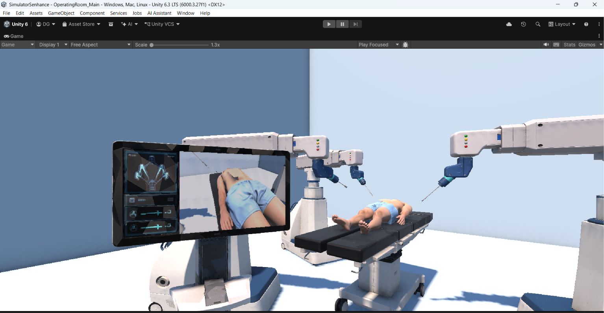

# Sistema Asistido por Robot Quirúrgico Senhance

**Miniproyecto #3 – Ingeniería Biomédica**

**Desarrollado por:** Diego Alejandro García García  
**Año:** 2026  
**Plataforma principal:** Unity 6  
**Lenguajes:** C# y Python

---

## 1. Descripción del proyecto

**SimulatorSenhance** es un simulador virtual de cirugía asistida por robot, desarrollado en Unity y basado en el sistema quirúrgico Senhance de Asensus Surgical.

El proyecto permite representar un entorno quirúrgico tridimensional y realizar la manipulación virtual de brazos robóticos, instrumentos quirúrgicos y una cámara laparoscópica mediante un control inalámbrico DualShock 4.

Además de la simulación, se implementó un sistema de adquisición y almacenamiento de imágenes médicas en formato DICOM, procesamiento de imágenes mediante inteligencia artificial y un visor local de estudios denominado **Mini-PACS**.

El sistema permite integrar las capturas generadas en Unity con su correspondiente estudio DICOM, realizar análisis anatómicos experimentales y generar informes PDF con los resultados obtenidos.

El proyecto tiene fines exclusivamente académicos y de simulación.



*Figura 1. Entorno quirúrgico virtual desarrollado en Unity.*

## 2. Objetivo general

Desarrollar un entorno virtual de simulación quirúrgica asistida por robot que permita controlar instrumentos quirúrgicos, adquirir imágenes médicas y analizar experimentalmente regiones anatómicas mediante herramientas de visión artificial, integrando los resultados en un sistema local de gestión de estudios.

## 3. Tecnologías utilizadas

| Tecnología | Aplicación |
|---|---|
| Unity 6 | Desarrollo del simulador quirúrgico tridimensional |
| C# | Programación de brazos robóticos, instrumental y controles |
| DualShock 4 | Manipulación inalámbrica del sistema robótico |
| Python | Integración de módulos de procesamiento y visualización |
| OpenCV | Segmentación y detección de candidatos de incisión |
| MediaPipe | Identificación experimental de referencias anatómicas |
| NumPy | Procesamiento y operaciones numéricas |
| pydicom | Lectura y organización de estudios DICOM |
| Tkinter | Interfaz gráfica del mini-PACS |
| Pillow | Visualización de imágenes procesadas |
| ReportLab | Generación de informes PDF |
| PyMuPDF | Visualización de informes PDF |
| Weasis | Visualización especializada de archivos DICOM |
| GitHub | Control de versiones y documentación |

## 4. Arquitectura general

El proyecto integra los siguientes componentes:

1. **Control robótico:** manipulación de instrumentos mediante DualShock 4.
2. **Simulación quirúrgica:** representación y ejecución de movimientos en Unity.
3. **Adquisición DICOM:** generación de capturas PNG y archivos DICOM.
4. **Procesamiento IA:** reconocimiento anatómico y detección experimental de incisiones.
5. **Mini-PACS:** archivado, consulta y visualización de estudios.
6. **Informes:** generación y consulta de resultados en PDF.

**[INSERTAR IMAGEN: docs/arquitectura.png]**

*Figura 2. Arquitectura de integración del sistema SimulatorSenhance.*

## 5. Funcionalidades desarrolladas

### 5.1. Simulación robótica

El entorno virtual incluye un paciente sobre una mesa quirúrgica, brazos robóticos articulados, instrumentos laparoscópicos y una cámara de visualización.

Se implementaron funciones de:

- Control de movimiento mediante DualShock 4.
- Manipulación de brazos robóticos.
- Cinemática inversa y restricciones de movimiento.
- Apertura y cierre de instrumentos.
- Alternancia entre control de brazos y cámara.
- Retorno a posición inicial (HOME).
- Paro virtual de emergencia.
- Interacción con objetos e instrumental quirúrgico.
- Simulación de procedimientos de sutura.

**[INSERTAR IMAGEN: docs/img/02_control.png]**

*Figura 3. Manipulación de instrumentos robóticos dentro del simulador.*

**[INSERTAR IMAGEN: docs/img/03_sutura.png]**

*Figura 4. Simulación del procedimiento de sutura quirúrgica.*

### 5.2. Captura y almacenamiento DICOM

El simulador permite generar capturas del entorno quirúrgico en formato PNG y archivos DICOM con identificadores y metadatos del estudio simulado.

El módulo de archivado desarrollado en Python permite:

- Detectar nuevos archivos DICOM generados por Unity.
- Organizar los archivos por paciente, estudio y serie.
- Conservar los identificadores DICOM.
- Mantener un índice de asociación entre capturas y estudios.
- Actualizar automáticamente los registros desde el mini-PACS.

### 5.3. Procesamiento de imágenes mediante IA

Se implementó un módulo experimental de análisis quirúrgico utilizando MediaPipe y OpenCV.

El procesamiento permite identificar referencias anatómicas del paciente, delimitar una región abdominal aproximada y detectar posibles regiones de incisión mediante segmentación de imagen.

Entre los resultados obtenidos se incluyen:

- Mapeo anatómico de hombros, caderas y abdomen.
- Detección de candidatos de incisión.
- Identificación de contornos.
- Cálculo del centro de la región detectada.
- Estimación del ancho, alto y área en píxeles.
- Almacenamiento de resultados asociados a cada captura.

**[INSERTAR IMAGEN: docs/img/05_ia_abdomen.png]**

*Figura 5. Identificación de referencias anatómicas y delimitación abdominal.*

**[INSERTAR IMAGEN: docs/img/06_ia_incision.png]**

*Figura 6. Detección experimental de una región de incisión mediante OpenCV.*

Los resultados corresponden a un entorno virtual y no representan mediciones clínicas validadas.

### 5.4. Mini-PACS y visualización de estudios

Se desarrolló una aplicación local de gestión de estudios DICOM mediante Python y Tkinter.

La interfaz permite:

- Consultar pacientes y estudios archivados.
- Actualizar automáticamente los registros DICOM.
- Buscar y filtrar estudios.
- Visualizar metadatos de los archivos.
- Abrir imágenes DICOM mediante Weasis.
- Ejecutar el análisis IA desde la interfaz cuando sea necesario.
- Consultar las imágenes procesadas correspondientes a cada estudio.
- Visualizar y guardar informes PDF.

**[INSERTAR IMAGEN: docs/img/04_pacs.png]**

*Figura 7. Interfaz principal del mini-PACS SimulatorSenhance.*

### 5.5. Generación de informes quirúrgicos

El sistema permite generar informes PDF asociados a las capturas analizadas.

Los documentos incluyen información del paciente simulado, procedimiento, metodología, evidencia visual y resultados del procesamiento.

Cuando se identifica un candidato de incisión, el informe incorpora las mediciones obtenidas por el algoritmo, incluyendo centro, dimensiones y área.

**[INSERTAR IMAGEN: docs/img/07_pdf.png]**

*Figura 8. Informe de análisis quirúrgico generado automáticamente.*

## 6. Organización del repositorio

```text
sistema-asistido-robot-senhance/
├── src/
│   ├── simulacion/
│   ├── modelos/
│   └── api/
│       ├── dicom/
│       ├── ia/
│       ├── visor/
│       └── requirements.txt
├── datos/
│   ├── pacientes/
│   └── dicom_ejemplo/
├── docs/
│   ├── documento_tecnico.md
│   ├── arquitectura.png
│   └── img/
├── README.md
├── GUIA_USUARIO.md
├── LICENSE.md
└── .gitignore
```

## 7. Instalación y ejecución

Para utilizar el proyecto se requiere:

- Unity 6 con los paquetes correspondientes al proyecto.
- Python con las dependencias indicadas en `src/api/requirements.txt`.
- Un control DualShock 4 para la manipulación robótica.
- Weasis para la visualización especializada de estudios DICOM.

El simulador se encuentra en `src/simulacion/` y los módulos Python están organizados en `src/api/`.

La configuración de rutas, dependencias y procedimientos de ejecución se documenta en los siguientes archivos:

- [Guía de usuario](GUIA_USUARIO.md)
- [Documento técnico](docs/documento_tecnico.md)

## 8. Resultados obtenidos

Se logró desarrollar un prototipo funcional que integra la simulación robótica con la adquisición de imágenes y el procesamiento experimental mediante inteligencia artificial.

Entre los resultados principales destacan:

- Manipulación virtual de instrumentos quirúrgicos.
- Control inalámbrico de brazos robóticos.
- Simulación de movimientos y procedimientos de sutura.
- Generación y organización de estudios DICOM.
- Detección experimental de regiones anatómicas e incisiones.
- Visualización integrada de resultados de IA.
- Generación automática de informes PDF.
- Gestión local de estudios mediante mini-PACS.

## 9. Video demostrativo

**Video del funcionamiento:** pendiente de incorporar el enlace de YouTube.

La demostración incluirá el control robótico, la interacción con el entorno quirúrgico, la captura DICOM, el análisis mediante inteligencia artificial y la visualización de resultados en el mini-PACS.

## 10. Documentación

- [Guía de usuario](GUIA_USUARIO.md)
- [Documento técnico](docs/documento_tecnico.md)
- [Licencia del proyecto](LICENSE.md)

## 11. Alcance y limitaciones

SimulatorSenhance es un prototipo académico destinado a la representación y experimentación de sistemas quirúrgicos asistidos por robot.

El mini-PACS es un sistema de almacenamiento y consulta local, no una infraestructura PACS hospitalaria en red.

El procesamiento mediante inteligencia artificial utiliza técnicas experimentales de reconocimiento corporal y visión artificial. Las regiones detectadas y sus dimensiones no constituyen resultados clínicamente validados.

El proyecto no es un dispositivo médico certificado y no está diseñado para diagnóstico, tratamiento ni procedimientos quirúrgicos reales.

## 12. Autor

**Diego Alejandro García García**  
Ingeniería Biomédica  
Universidad Mariano Gálvez de Guatemala  
2026

Proyecto académico desarrollado como parte del Miniproyecto #3.

## 13. Licencia

El código propio del proyecto se distribuye bajo los términos establecidos en [LICENSE.md](LICENSE.md). Los modelos, bibliotecas y recursos de terceros están sujetos a sus respectivas licencias.
