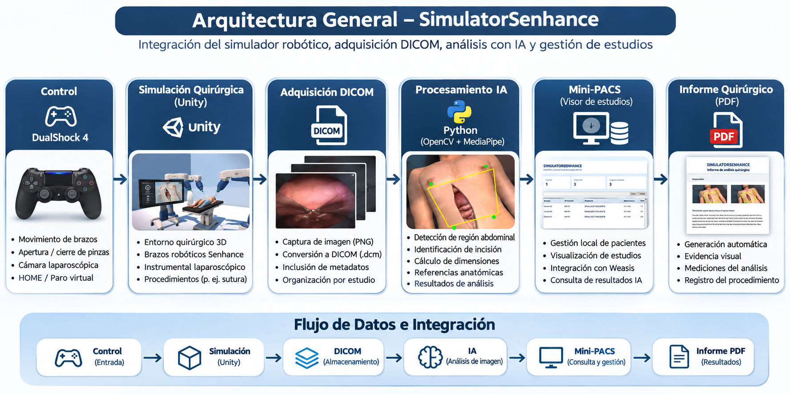
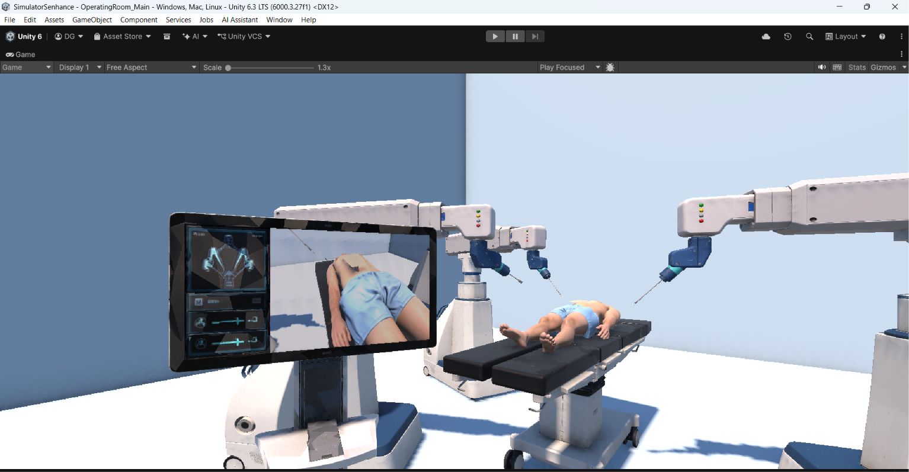
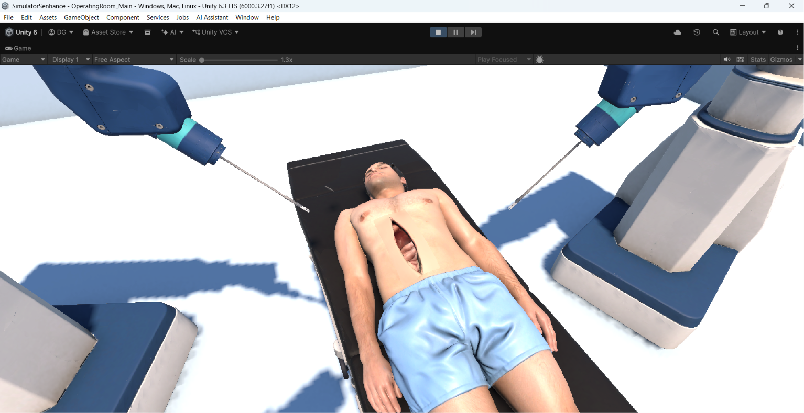
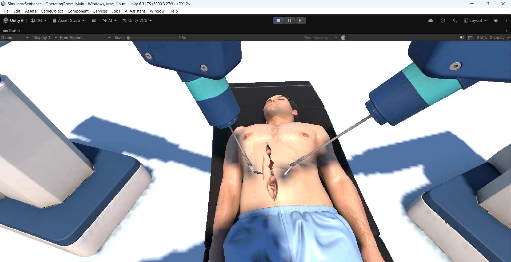
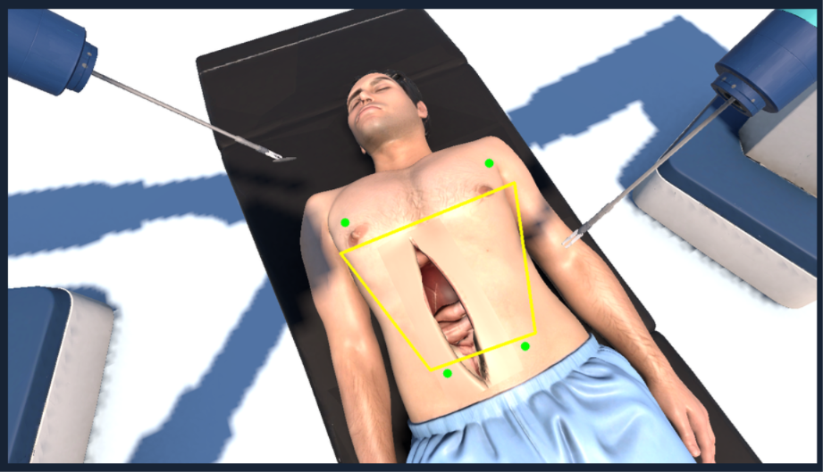
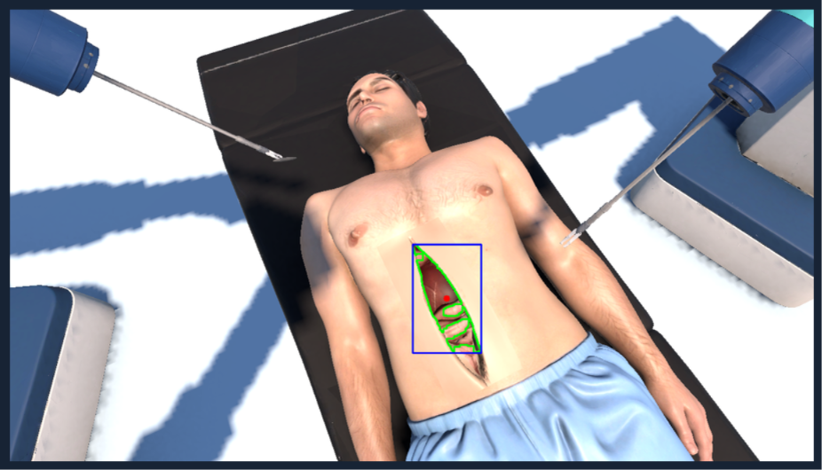
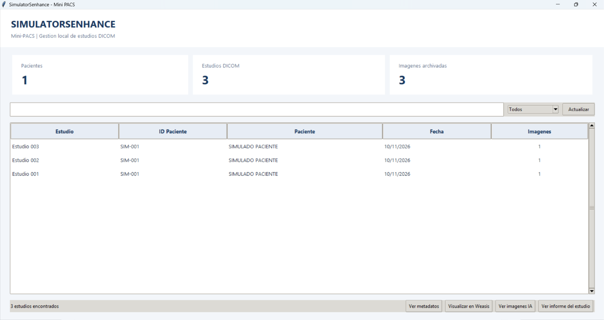
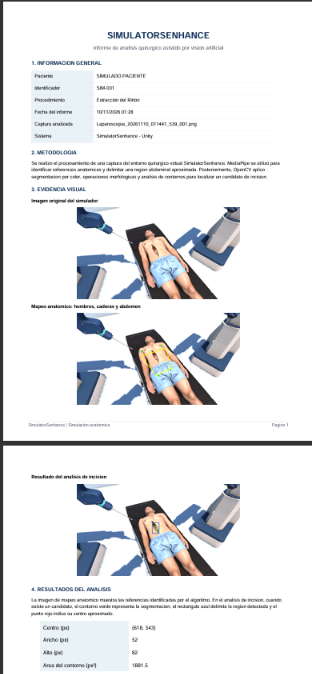

# Documento Técnico – SimulatorSenhance

**Proyecto:** Sistema Asistido por Robot Quirúrgico Senhance  
**Autor:** Diego Alejandro García García  
**Miniproyecto:** #3 – Ingeniería Biomédica  
**Año:** 2026  
**Plataforma principal:** Unity 6  
**Lenguajes:** C# y Python

---

## 1. Introducción

SimulatorSenhance es un prototipo académico de simulación quirúrgica desarrollado en Unity, inspirado en el sistema robótico Senhance de Asensus Surgical.

El proyecto integra un entorno quirúrgico tridimensional, brazos robóticos articulados, instrumentos laparoscópicos y un sistema de control mediante DualShock 4, permitiendo simular movimientos y procedimientos quirúrgicos.

Adicionalmente, se desarrolló un sistema complementario en Python que permite gestionar las imágenes obtenidas desde Unity, organizar estudios en formato DICOM y realizar análisis experimentales mediante inteligencia artificial y procesamiento digital de imágenes.

Para visualizar los resultados, se implementó un Mini-PACS local que permite consultar estudios, visualizar imágenes mediante Weasis, revisar los resultados del análisis quirúrgico y acceder a informes generados automáticamente en formato PDF.

El propósito del proyecto es integrar conocimientos de robótica, programación, simulación médica y visión artificial en una plataforma educativa que represente diferentes etapas de un procedimiento quirúrgico asistido por robot.

El sistema tiene fines exclusivamente académicos y no está diseñado para uso clínico real.

## 2. Arquitectura general del sistema

SimulatorSenhance está organizado en módulos que permiten integrar el control robótico, la simulación virtual, la adquisición de imágenes y su posterior procesamiento.



*Figura 1. Arquitectura general e integración de los módulos de SimulatorSenhance.*

### 2.1 Entorno virtual

El entorno quirúrgico fue desarrollado en Unity e incluye la representación tridimensional del paciente, camilla, brazos robóticos, instrumentos quirúrgicos, monitores y cámara laparoscópica.

La escena principal permite observar la interacción entre los instrumentos y el paciente simulado.



*Figura 2. Entorno quirúrgico virtual desarrollado en Unity.*

### 2.2 Sistema de control robótico

El control se realiza mediante un DualShock 4 conectado a la computadora.

Los scripts desarrollados en C# interpretan las entradas del mando para controlar los movimientos de los brazos, la manipulación de instrumentos y las funciones de seguridad.

### 2.3 Adquisición y almacenamiento DICOM

Las capturas generadas desde Unity se almacenan localmente y se asocian con estudios médicos simulados en formato DICOM.

Los archivos se organizan mediante identificadores de paciente, estudio, serie e imagen, facilitando su posterior consulta.

### 2.4 Procesamiento mediante inteligencia artificial

Las capturas son procesadas mediante Python, OpenCV y MediaPipe.

El sistema permite identificar puntos corporales de referencia, delimitar una región abdominal aproximada y detectar posibles regiones de incisión mediante segmentación de imágenes.

### 2.5 Visualización e informes

El Mini-PACS permite consultar los estudios archivados, visualizar sus metadatos, abrir imágenes DICOM mediante Weasis y revisar los resultados generados por el análisis.

Adicionalmente, el sistema genera informes automáticos en PDF asociados con las capturas procesadas.

## 3. Tecnologías utilizadas

| Tecnología | Aplicación |
|---|---|
| Unity 6 | Desarrollo del entorno quirúrgico tridimensional |
| C# | Programación de controles y comportamiento robótico |
| DualShock 4 | Control inalámbrico de los brazos e instrumentos |
| Python | Automatización y procesamiento de imágenes |
| OpenCV | Segmentación y detección de contornos |
| MediaPipe | Reconocimiento experimental de puntos corporales |
| NumPy | Operaciones matriciales y procesamiento numérico |
| pydicom | Lectura y organización de archivos DICOM |
| Tkinter | Desarrollo de la interfaz gráfica del Mini-PACS |
| Pillow | Visualización de imágenes procesadas |
| PyMuPDF | Visualización y procesamiento de documentos PDF |
| Weasis | Visualización especializada de estudios DICOM |
| GitHub | Almacenamiento del código y documentación |

## 4. Requisitos del sistema

### 4.1 Hardware

- Computadora compatible con Unity 6.
- Control DualShock 4.
- Conexión Bluetooth o USB compatible.
- Espacio de almacenamiento para el simulador y sus capturas.

### 4.2 Software

- Unity Hub.
- Unity 6, utilizando la versión indicada en el proyecto.
- Python compatible con las dependencias utilizadas.
- Visual Studio o editor compatible con C# y Python.
- Git.
- Weasis para visualizar estudios DICOM.

El desarrollo y las pruebas se realizaron principalmente en Windows.

## 5. Instalación y configuración

### 5.1 Obtener el repositorio

Clonar el repositorio desde GitHub:

```bash
git clone https://github.com/dgarciag44/sistema-asistido-robot-senhance.git
```

### 5.2 Abrir el proyecto en Unity

1. Abrir Unity Hub.
2. Seleccionar la opción para agregar un proyecto existente.
3. Buscar la carpeta `src/simulacion/`.
4. Abrir el proyecto con la versión de Unity correspondiente.
5. Localizar la escena `OperatingRoom_Main`.
6. Conectar el DualShock 4.
7. Ejecutar la simulación mediante el botón Play.

### 5.3 Configurar Python

Acceder a la carpeta de los módulos complementarios:

```bash
cd src/api
```

Crear un entorno virtual:

```bash
python -m venv .venv
```

Activarlo en Windows:

```powershell
.\.venv\Scripts\Activate.ps1
```

Instalar las dependencias:

```bash
python -m pip install -r requirements.txt
```

El archivo `requirements.txt` contiene las dependencias necesarias para los módulos de procesamiento y visualización.

### 5.4 Configuración de rutas

Los módulos Python utilizan directorios locales para localizar las capturas generadas por Unity, los estudios DICOM y los resultados del procesamiento.

Antes de ejecutar el sistema en otra computadora, es necesario revisar las rutas configuradas en los scripts y adaptarlas al entorno correspondiente.

Las capturas de Unity se generan en el directorio local de datos de la aplicación.

### 5.5 Modelo MediaPipe

El reconocimiento corporal utiliza un modelo Pose Landmarker compatible con MediaPipe Tasks.

El repositorio incluye el archivo:

`src/api/ia/pose_landmarker_recuperado.task`

El script de análisis debe estar configurado para localizar correctamente este archivo.

### 5.6 Ejecución de los módulos

Los componentes principales del sistema se encuentran organizados en las siguientes rutas:

| Archivo | Función |
|---|---|
| `src/api/dicom/archivo_dicom.py` | Organización de estudios DICOM |
| `src/api/dicom/verificar_dicom.py` | Verificación de archivos DICOM |
| `src/api/ia/analisis_quirurgico.py` | Procesamiento de capturas |
| `src/api/ia/detectar_pose.py` | Reconocimiento corporal |
| `src/api/ia/detectar_incision.py` | Procesamiento de incisiones |
| `src/api/visor/visor_dicom.py` | Interfaz gráfica del Mini-PACS |
| `src/api/visor/generar_informe.py` | Generación de informes PDF |

Los scripts se ejecutan mediante Python, utilizando el entorno virtual configurado. Su funcionamiento integrado requiere conservar las rutas y referencias entre módulos.

## 6. Control y cinemática del robot

El simulador incorpora mecanismos de control que permiten manipular los brazos quirúrgicos y sus instrumentos mediante un mando inalámbrico.

### 6.1 Control mediante DualShock 4

Los joysticks permiten controlar los movimientos de los brazos izquierdo y derecho.

Se implementaron funciones para alternar el control de los brazos y la cámara laparoscópica, además de controlar la apertura y el cierre de los instrumentos.



*Figura 3. Manipulación de instrumentos mediante el sistema de control robótico.*

### 6.2 Cinemática inversa

Se desarrollaron mecanismos de cinemática inversa para orientar los brazos hacia objetivos virtuales.

El sistema permite realizar movimientos articulados y mantener restricciones relacionadas con el alcance y las posiciones de las articulaciones.

### 6.3 Restricciones y seguridad

Entre las funciones implementadas se encuentran:

- Límites de movimiento articular.
- Restricciones de alcance.
- Modo de precisión.
- Paro de emergencia virtual.
- Retorno a posición HOME.
- Alternancia de control entre brazos y cámara.

Estas funciones representan mecanismos de seguridad simulados y no equivalen a sistemas de protección certificados para equipos quirúrgicos reales.

### 6.4 Manipulación y sutura quirúrgica

El entorno incluye interacciones con instrumentos quirúrgicos y objetos virtuales.

Se desarrollaron mecanismos para sujetar, liberar y transferir objetos entre instrumentos, así como una secuencia experimental de aproximación de tejido y sutura.



*Figura 4. Interacción de instrumentos y simulación del procedimiento de sutura.*

## 7. Captura y procesamiento de imágenes

### 7.1 Adquisición de imágenes

Las imágenes se obtienen desde el entorno virtual de Unity y se almacenan localmente para su procesamiento posterior.

Las capturas representan diferentes perspectivas del paciente y del campo quirúrgico simulado.

### 7.2 Reconocimiento corporal mediante MediaPipe

El sistema utiliza MediaPipe Pose Landmarker para identificar puntos anatómicos de referencia.

Entre los puntos empleados se encuentran:

- Hombro izquierdo.
- Hombro derecho.
- Cadera izquierda.
- Cadera derecha.

A partir de estas referencias se calcula una región aproximada correspondiente al abdomen del paciente virtual.



*Figura 5. Identificación de referencias corporales y delimitación experimental de la región abdominal.*

### 7.3 Detección de incisiones mediante OpenCV

Se desarrolló un procedimiento de segmentación basado en procesamiento digital de imágenes.

El algoritmo realiza las siguientes operaciones:

1. Lectura de la captura original.
2. Conversión al espacio de color HSV.
3. Identificación de regiones oscuras y rojizas.
4. Aplicación de una máscara abdominal.
5. Operaciones morfológicas para reducir ruido.
6. Extracción y evaluación de contornos.
7. Identificación de una región candidata de incisión.
8. Cálculo de centro, dimensiones y área aproximada.



*Figura 6. Detección experimental de una región candidata de incisión mediante OpenCV.*

### 7.4 Resultados del procesamiento

El análisis genera imágenes complementarias que representan:

- Delimitación de la región abdominal.
- Detección de la región candidata de incisión.
- Máscara utilizada durante el procesamiento.

También se obtienen valores geométricos aproximados, expresados en píxeles, que permiten describir la región detectada.

Los resultados dependen de la perspectiva, iluminación y características visuales de la escena.

### 7.5 Automatización

El procesamiento se integra con la generación de informes y la organización de estudios DICOM.

De esta manera, las capturas pueden relacionarse con sus resultados de análisis y visualizarse posteriormente desde el Mini-PACS.

## 8. Sistema de almacenamiento y visualización DICOM

### 8.1 Organización de estudios

Se desarrolló un módulo que permite organizar los archivos DICOM generados por el simulador.

La estructura utiliza identificadores para clasificar los archivos por paciente, estudio y serie.

Los estudios contienen metadatos que permiten identificar las imágenes y facilitar su consulta.

### 8.2 Mini-PACS

Se implementó una aplicación gráfica local mediante Tkinter para gestionar los estudios archivados.

La interfaz permite:

- Consultar pacientes y estudios disponibles.
- Visualizar la cantidad de imágenes archivadas.
- Buscar y filtrar estudios.
- Actualizar el listado de estudios.
- Consultar metadatos DICOM.
- Abrir imágenes mediante Weasis.
- Visualizar resultados del análisis por IA.
- Consultar informes PDF correspondientes a los estudios.



*Figura 7. Interfaz del Mini-PACS local para la gestión de estudios DICOM.*

### 8.3 Visualización mediante Weasis

El Mini-PACS permite abrir los archivos DICOM seleccionados mediante Weasis.

Esto facilita la revisión de las imágenes almacenadas y sus características dentro de un visor especializado.

### 8.4 Asociación de resultados por estudio

El sistema utiliza un índice de capturas para relacionar los archivos DICOM con las imágenes procesadas.

De esta manera, al seleccionar un estudio se pueden consultar los resultados correspondientes a la captura asociada, evitando mezclar imágenes de diferentes estudios.

### 8.5 Generación de informes PDF

Se desarrolló un módulo que genera automáticamente informes del análisis quirúrgico.

Los documentos incluyen información del paciente simulado, identificación de la captura, metodología, imágenes del procesamiento y resultados geométricos de la detección.

Los informes pueden consultarse desde la interfaz gráfica del Mini-PACS.



*Figura 8. Informe automático en formato PDF generado a partir del análisis de una captura.*

### 8.6 Datos de prueba

El repositorio incorpora información de ejemplo para demostrar el funcionamiento del sistema.

Las carpetas principales son:

- `datos/pacientes/`: registros ficticios y archivos de identificación de capturas.
- `datos/dicom_ejemplo/`: estudios DICOM de muestra.

Los datos corresponden a un entorno de simulación y no contienen información clínica de pacientes reales.

## 9. Pruebas realizadas

Durante el desarrollo se efectuaron pruebas funcionales de los componentes principales.

| Componente | Resultado |
|---|---|
| Conexión del DualShock 4 | Funcional |
| Control de brazos robóticos | Funcional |
| Cinemática inversa | Funcional en las pruebas realizadas |
| Apertura y cierre de instrumentos | Funcional |
| Manipulación y sutura simulada | Implementada y probada |
| Paro de emergencia virtual | Funcional |
| Retorno a HOME | Funcional |
| Captura de imágenes desde Unity | Funcional |
| Generación y organización de DICOM | Funcional en el entorno de pruebas |
| Lectura de metadatos DICOM | Funcional |
| Visualización mediante Weasis | Funcional |
| Reconocimiento corporal mediante MediaPipe | Funcional experimentalmente |
| Segmentación de incisión con OpenCV | Funcional experimentalmente |
| Visualización de resultados IA por estudio | Funcional |
| Generación de informes PDF | Funcional |
| Consulta de informes desde Mini-PACS | Funcional |

Los resultados corresponden a pruebas realizadas dentro del entorno académico del proyecto. No representan validación clínica ni certificación de desempeño.

## 10. Limitaciones del sistema

SimulatorSenhance constituye un prototipo académico y presenta limitaciones relacionadas con la fidelidad física, precisión anatómica y representación de procedimientos quirúrgicos.

La simulación no reproduce completamente las características mecánicas ni las condiciones operativas de un sistema quirúrgico real.

La detección de incisiones depende de las condiciones visuales de la escena y puede presentar errores ante cambios de perspectiva, iluminación o características de los modelos tridimensionales.

El Mini-PACS funciona como un sistema local de consulta y organización de estudios, sin implementar todas las capacidades de un PACS clínico de producción.

Los resultados de inteligencia artificial y los informes generados no deben utilizarse para diagnóstico, tratamiento ni toma de decisiones médicas.

## 11. Trabajo futuro

Entre las posibles mejoras se encuentran:

- Optimizar la precisión de los algoritmos de reconocimiento anatómico.
- Mejorar la segmentación de incisiones en diferentes perspectivas.
- Incorporar métricas de desempeño durante la manipulación quirúrgica.
- Ampliar los procedimientos de sutura e interacción con tejidos.
- Mejorar la fidelidad física de los instrumentos.
- Facilitar la instalación y configuración del sistema en otras computadoras.
- Ampliar las funciones de consulta y administración de estudios.
- Desarrollar mecanismos adicionales de evaluación de habilidades quirúrgicas.

## 12. Conclusiones

El desarrollo de SimulatorSenhance permitió integrar conocimientos de programación, robótica, cinemática, modelado tridimensional y procesamiento digital de imágenes en un entorno de simulación quirúrgica.

Se implementó un sistema de control robótico mediante DualShock 4, incorporando movimientos articulados, manipulación de instrumentos, funciones de seguridad y procedimientos simulados.

También se desarrolló un flujo de procesamiento de imágenes mediante Python, OpenCV y MediaPipe, permitiendo obtener resultados experimentales de reconocimiento anatómico y detección de incisiones.

La incorporación del formato DICOM, el Mini-PACS y la generación automática de informes PDF permitió ampliar el proyecto hacia la organización y consulta de información médica simulada.

En conjunto, el proyecto constituye una plataforma académica funcional que demuestra la integración de herramientas de ingeniería biomédica en un sistema virtual de cirugía asistida por robot.

---

**Nota:** SimulatorSenhance es un prototipo exclusivamente educativo. No constituye un dispositivo médico certificado y no está destinado a procedimientos clínicos reales.
